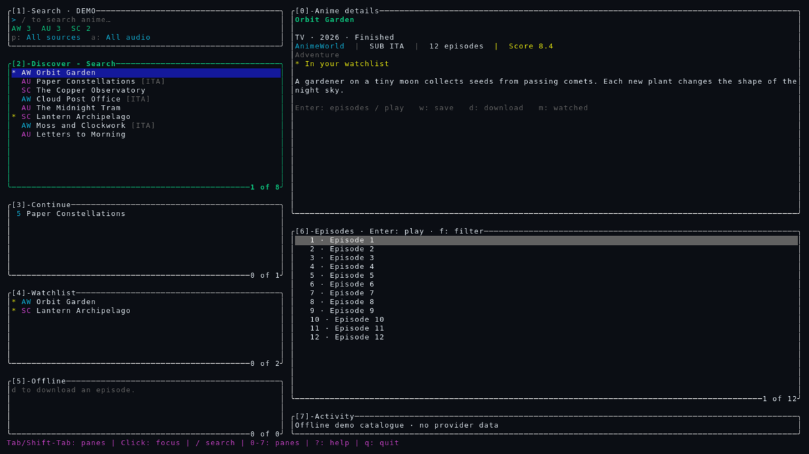
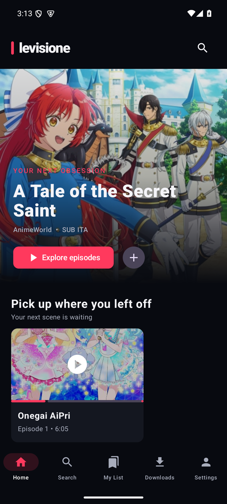
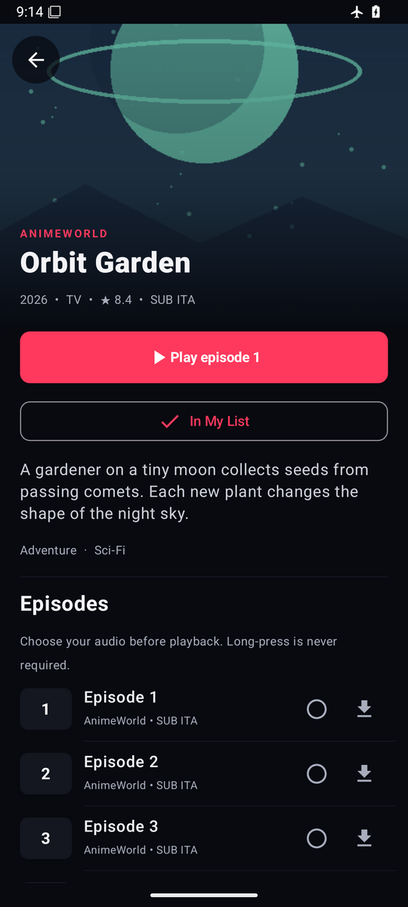
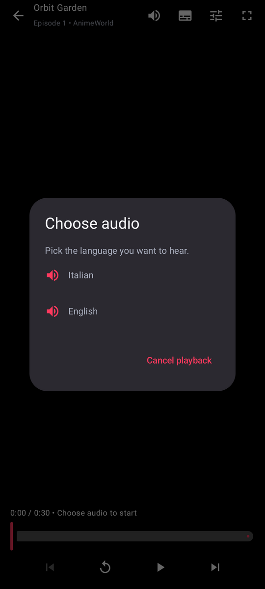
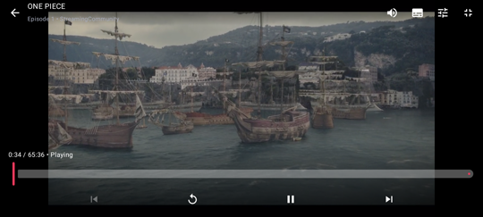

<div align="center">


# anime-levisione

[](https://github.com/k33wee/anime-levisione/actions/workflows/ci.yml)

[](https://www.gnu.org/licenses/gpl-3.0.html)

[English](README.md) · Italiano

</div>

Un browser anime per **terminale desktop** e **Android**. Entrambi i client cercano
su AnimeWorld, AnimeUnity e StreamingCommunity, salvano watchlist e progressi e
permettono di scegliere la lingua audio prima della riproduzione.

I provider offrono soprattutto contenuti doppiati o sottotitolati in italiano.
Cambiano dominio spesso: il core Rust condiviso cerca indirizzi alternativi
quando uno smette di funzionare.

**[TUI](#tui)** · **[App Android](#app-android)** · [Sviluppo](#sviluppo)

---

## TUI

Il client desktop: interfaccia a pannelli, scorciatoie da tastiera e supporto
mouse. VLC o mpv riproduce il video; il terminale resta disponibile per sfogliare
il catalogo.



*Catalogo dimostrativo offline: i titoli e le descrizioni mostrati sono inventati.*

### Installazione e avvio

Servono **Rust 1.88+** e **VLC o mpv**. Installa `ffmpeg` per i download;
`ffprobe` è facoltativo per rilevare le tracce audio nei formati diversi da HLS.
Funziona su Linux, macOS e Windows/WSL. Gli archivi di release non includono
un player multimediale.

Su Windows, VLC viene cercato nelle cartelle Program Files standard, accanto ad
`anime-levisione.exe` e nel `PATH`. Per un'installazione personalizzata usa, ad
esempio, `anime-levisione.exe --player "C:/percorso/di/vlc.exe"`.

```sh
git clone https://github.com/k33wee/anime-levisione
cd anime-levisione
cargo install --path crates/tui --locked

anime-levisione "frieren"
```

Altre opzioni di avvio:

```sh
anime-levisione --demo          # anteprima offline, senza rete né salvataggi
anime-levisione --player mpv    # scegli il player
anime-levisione --private       # disabilita AniList e la cronologia automatica
anime-levisione doctor          # controlla player, configurazione e provider
```

### Comandi

| Tasto | Azione |
| --- | --- |
| `/` | Cerca |
| `Tab` / `Shift+Tab`, `0`–`7` | Cambia pannello o vai direttamente a uno |
| `j/k`, frecce | Naviga |
| `Enter` | Apri un titolo / riproduci l'episodio selezionato |
| `s`, `n` | Ricomincia / episodio successivo |
| `w`, `m`, `d` | Watchlist / segna visto / scarica |
| `Ctrl+x`, `Ctrl+d` | Ferma la riproduzione / annulla il download |
| `?`, `:`, `q` | Scorciatoie / palette comandi / esci |

Clic per attivare un pannello o selezionare una riga, rotella per scorrere.
Il layout entra da 60×18; le finestre più piccole mostrano il pannello attivo.
Se sono disponibili più lingue audio, scegli con le frecce e conferma con `Enter`.

### Libreria e AniList

Watchlist, cronologia e punti di ripresa vengono salvati in locale. Premi `,`
per vedere i percorsi dei dati; `config.toml` contiene player, argomenti,
cartella download e mirror dei provider. `--data-dir` usa una libreria separata.

AniList è facoltativo. [Crea un client OAuth](https://anilist.co/settings/developer),
poi esegui:

```sh
anime-levisione login --client-id IL_TUO_ID
anime-levisione sync
anime-levisione logout
```

Puoi accedere anche dalla palette comandi. La sincronizzazione invia watchlist e
progressi senza abbassare quelli già presenti su AniList. La modalità privata
blocca le richieste AniList e i salvataggi automatici di cronologia e ricerche:
non cancella la libreria esistente né impedisce modifiche esplicite alla watchlist.

---

## App Android

Il client mobile usa Compose e Media3: non servono player esterni, `ffmpeg` o
`ffprobe`. Richiede **Android 8.0 o successivo**.

<p>



</p>

*Gli screenshot usano [illustrazioni originali e video sintetici](docs/screenshots/README.md),
non locandine o fotogrammi dei provider.*

- **Catalogo:** titolo in evidenza, righe per provider, filtri di ricerca e My List.
- **Visione:** punti di ripresa, episodi visti, cronologia ed episodio successivo
  automatico, se abilitato.
- **Player:** scelta audio prima della partenza, sottotitoli, limite qualità e
  schermo intero orizzontale. Tocca il video per play/pausa, avanzamento e altri
  comandi: durante la riproduzione si nascondono, senza rimpicciolire il video.
- **Download:** episodi HLS/MP4 con preferenze audio e qualità, solo Wi-Fi di
  default. I download completati funzionano dalla cache dell'app anche se il
  link originale scade. Si possono sospendere, riprendere e rimuovere da Downloads.
- **Impostazioni:** metadati, accesso e sincronizzazione AniList, modalità privata,
  mirror dei provider e diagnostica della connessione.



### Scaricare l'app

I pacchetti sono allegati alle [release](https://github.com/k33wee/anime-levisione/releases/latest):

- `anime-levisione-<versione>-android.apk` — pacchetto Android firmato (Android 8+)
- `anime-levisione-<versione>-<piattaforma>.tar.gz|.zip` — binari TUI per Linux
  (glibc 2.35+), macOS (Apple Silicon e Intel) e Windows x86_64
- `SHA256SUMS` — checksum di tutti gli asset

Scarica l'APK sul telefono e aprilo, oppure installa con ADB:

```sh
adb install anime-levisione-<versione>-android.apk
```

L'APK di release è firmato con la chiave di release del progetto. Le build di
debug (artefatti CI, `assembleDebug`) usano una chiave diversa: Android rifiuta
l'aggiornamento dall'una all'altra e la disinstallazione cancella libreria e
download locali. Usa l'APK di release.

<details>
<summary>Alternative</summary>

- APK e AAB di debug da una qualsiasi
  [run CI riuscita su main](https://github.com/k33wee/anime-levisione/actions/workflows/ci.yml?query=branch%3Amain)
  (artefatto `android-debug`, serve l'accesso a GitHub). L'AAB non si installa
  direttamente.
- Compilare dai sorgenti — configura Rust, JDK 17+, SDK Android e NDK come
  descritto nella [guida di compilazione Android](android/README.md#build), poi:

```sh
./android/build-rust-android.sh
./android/gradlew -p android :app:assembleDebug
adb install -r android/app/build/outputs/apk/debug/app-debug.apk
```

</details>

### Libreria e account

Download, libreria e credenziali AniList restano nello spazio privato dell'app.
Rimuovere un download conserva i progressi; disinstallare l'app elimina i suoi
dati. Il formato della libreria è quello della TUI, ma file e punti di ripresa
non vengono condivisi automaticamente fra dispositivi.

Per collegare AniList, inserisci il client ID OAuth in Settings, autorizza nel
browser e incolla il token o l'URL di ritorno. La modalità privata disabilita i
nuovi salvataggi automatici di cronologia e ricerche e le richieste AniList, non
i dati già presenti o le modifiche esplicite.

[Configurazione, test e dettagli sullo spazio dati Android →](android/README.md)

---

## Sviluppo

```sh
make help        # target disponibili
make ci          # fmt, clippy, test e commitlint; da eseguire prima del push
make bindings    # rigenera i binding Kotlin dopo modifiche alla core API
make hooks       # abilita gli hook commit-msg e pre-push
make act         # esegue il workflow GitHub in locale; richiede Docker
```

| Percorso | Contenuto |
| --- | --- |
| `crates/core` | Provider, libreria e AniList; condivisi tramite UniFFI |
| `crates/tui` | Applicazione da terminale |
| `crates/bindgen` | Generatore dei binding Kotlin |
| `android` | Applicazione Android e script di compilazione |
| `docs/branding` | [Icona modificabile e generazione delle risorse](docs/branding/README.md) |

La CI verifica Rust su Linux, macOS e Windows, controlla i binding generati e
compila, analizza e testa Android su emulatori API 26 e 35. I commit seguono i
[Conventional Commits](https://www.conventionalcommits.org/it).

## Licenza

GPL-3.0-only. Non vengono distribuiti contenuti. Il progetto non è affiliato ai
provider, ad AniList o a Rai/Melevisione. La disponibilità dipende dai servizi
originali; usali nel rispetto dei diritti e delle condizioni applicabili.
