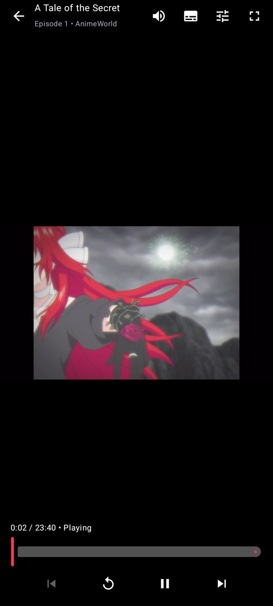
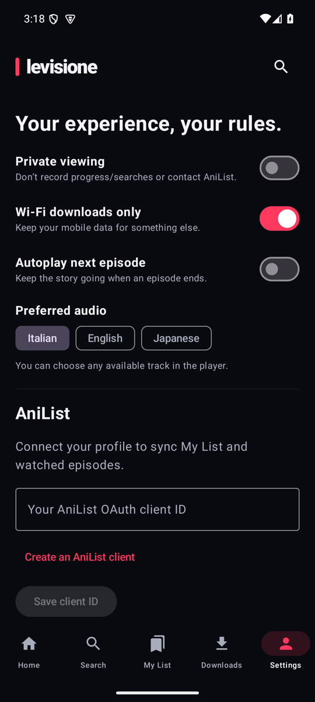

<div align="center">

# anime-levisione

**Find it. Pick your audio. Press play.**

[](https://github.com/k33wee/anime-levisione/actions/workflows/ci.yml)


[](https://www.gnu.org/licenses/gpl-3.0.html)

[English](README.md) · [Italiano](README.it.md)

</div>

anime-levisione is a keyboard-first anime browser that behaves the way lazygit does: the interface stays out of your way and everything is a keypress away. It searches AnimeWorld, AnimeUnity and StreamingCommunity at the same time, remembers where you stopped watching, and hands playback to VLC or mpv with the audio track you asked for.

The providers are Italian, so most titles come with Italian subtitles and many with an Italian dub. They also keep changing domains — when that happens, anime-levisione goes looking for the new address on its own and gets out of your way again.

Since 0.2.0 the same core powers an Android app too: a poster-first home screen, offline downloads, and a player that asks which language you want *before* the episode starts, Netflix-style chrome included.

| Terminal | Android |
| :---: | :---: |
|  |    |

## Install (terminal)

You need **Rust 1.88+** and **VLC or mpv**. Add `ffmpeg` if you want downloads; `ffprobe` is optional and only used to detect audio languages in local files. Linux, macOS and Windows/WSL.

```sh
git clone https://github.com/k33wee/anime-levisione
cd anime-levisione
cargo install --path crates/tui --locked
```

Then:

```sh
anime-levisione "frieren"       # search and browse
anime-levisione --demo          # offline preview, no network, no saved data
anime-levisione --player mpv    # override the player
anime-levisione --private       # no AniList, no automatic history
anime-levisione doctor          # check players, config and providers
```

Everything fits from **60×18** up; smaller windows zoom the focused pane.

| Key | Action |
| --- | --- |
| `/` | Search |
| `Tab` / `Shift+Tab` · `0`–`7` | Switch / jump to pane |
| `j/k` · arrows | Navigate |
| `Enter` · `s` · `n` | Episodes / restart / next episode |
| `w` · `m` · `d` | Watchlist · mark watched · download |
| `Ctrl+x` · `Ctrl+d` | Stop playback · cancel download |
| `?` · `:` · `q` | Shortcuts · command palette · quit |

The mouse works too: click to focus a pane or pick a row, wheel to scroll.

**Audio.** When an episode has more than one language you get a picker before playback; pick with the arrows and confirm with `Enter`. HLS needs no extra tools, other files use `ffprobe` when available, and when in doubt the player default applies.

**AniList, opt-in.** [Create an OAuth client](https://anilist.co/settings/developer), then `anime-levisione login --client-id YOUR_ID` — or log in from the command palette. Sync pushes your watchlist and progress but never downgrades what's already on AniList. `logout` disconnects; `--private` keeps the app from ever talking to AniList or writing history.

**Files.** `,` shows where everything lives. `config.toml` holds player, player args, download folder and provider mirrors; `--data-dir` keeps a separate library.

## Android

<p>





</p>

Same providers, same library format as the terminal app, wrapped in a dark, artwork-first UI:

- Home with featured title, continue-watching and per-provider rows; search with filters
- My List, resume points, watched episodes, viewing history
- Player with pre-play audio picker, subtitles, quality cap, fullscreen, autoplay-next
- Offline downloads (native HLS/MP4, Wi-Fi only by default) that survive dead links
- AniList metadata, login and sync; private mode; provider mirrors and diagnostics

Build it from source — see [android/README.md](android/README.md) for the full guide:

```sh
./android/build-rust-android.sh
./android/gradlew -p android :app:assembleDebug
adb install -r android/app/build/outputs/apk/debug/app-debug.apk
```

CI also uploads a freshly built APK and AAB as artifacts of every run on `main`. Not available on Google Play: it's a scraping-based client, so it's side-load only.

## Development

```sh
make help        # all targets
make ci          # fmt + clippy + tests + commitlint (run before pushing)
make bindings    # regenerate the Kotlin bindings after core API changes
make hooks       # commit-msg / pre-push hooks
make act         # replay the GitHub workflow locally (needs Docker)
```

Commits follow [Conventional Commits](https://www.conventionalcommits.org) and are checked by commitlint in CI. The workspace is split in three crates: `crates/core` (providers, AniList, library — everything portable, shared with Android through UniFFI), `crates/tui` (the terminal app) and `crates/bindgen` (Kotlin bindings generator). CI runs the Rust suite on Linux, macOS and Windows, and builds plus smoke-tests the Android app on emulators running Android 8 and 15.

## License

GPL-3.0-only. This project is not affiliated with AnimeWorld, AnimeUnity, StreamingCommunity or AniList, and ships no content: it's a player for services you already use, so it comes with no warranty and a modicum of common sense.
