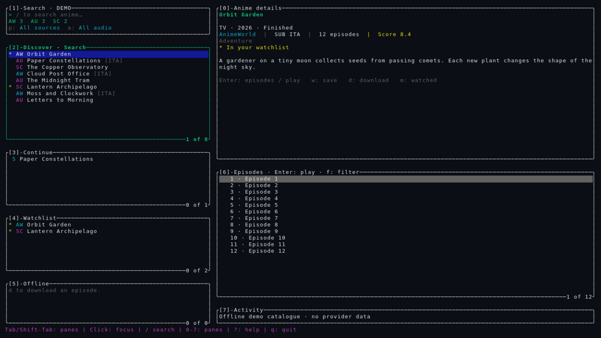
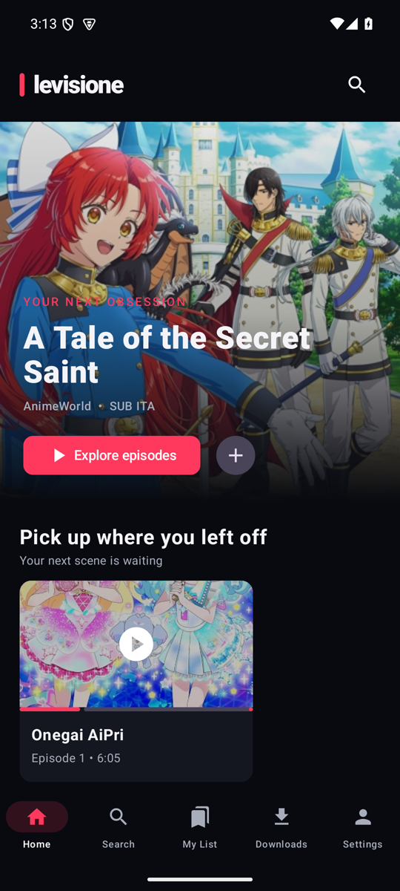
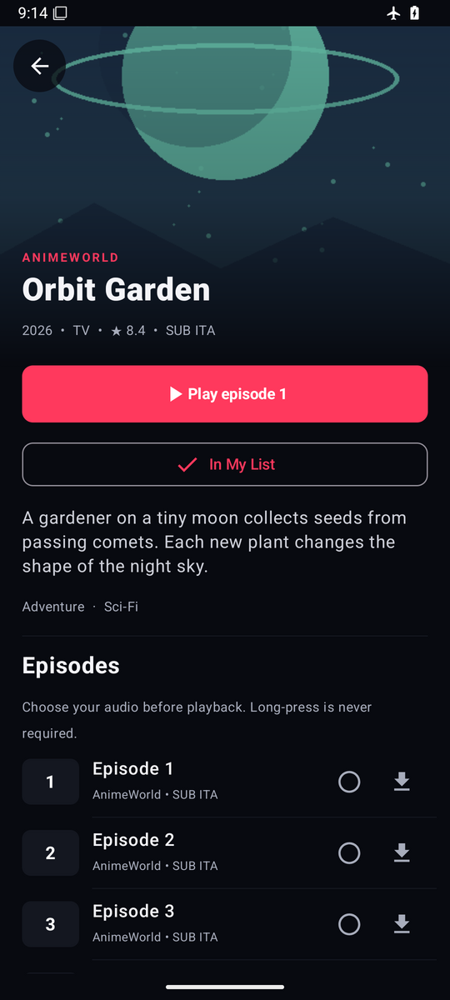
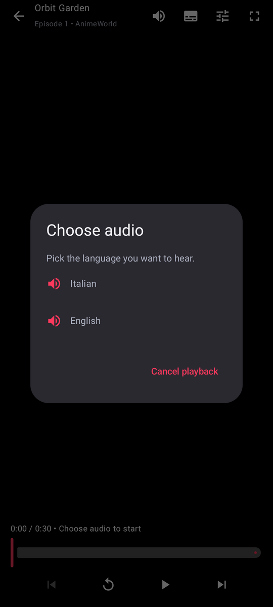
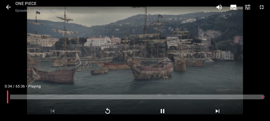

<div align="center">


# anime-levisione

[](https://github.com/k33wee/anime-levisione/actions/workflows/ci.yml)

[](https://www.gnu.org/licenses/gpl-3.0.html)

English · [Italiano](README.it.md)

</div>

An anime browser for **desktop terminals** and **Android**. Both clients search
AnimeWorld, AnimeUnity and StreamingCommunity, keep a watchlist and viewing
progress, and let you choose the audio language before playback.

The providers serve mainly Italian-dubbed and Italian-subtitled content. Their
domains change often; the shared Rust core checks alternative addresses when one
stops working.

**[TUI](#tui)** · **[Android app](#android-app)** · [Development](#development)

---

## TUI

The desktop client: a pane-based interface with keyboard shortcuts and mouse
support. VLC or mpv plays the video; the terminal stays available for browsing.



*Offline sample catalogue: the titles and descriptions shown are fictional.*

### Install and run

Requires **Rust 1.88+** and **VLC or mpv**. Install `ffmpeg` for downloads;
`ffprobe` is optional for audio-track detection outside HLS. Runs on Linux,
macOS and Windows/WSL. Release archives do not bundle a media player.

On Windows, VLC is detected in its standard Program Files locations, beside
`anime-levisione.exe`, or through `PATH`. For a custom installation, run e.g.
`anime-levisione.exe --player "C:/path/to/vlc.exe"`.

```sh
git clone https://github.com/k33wee/anime-levisione
cd anime-levisione
cargo install --path crates/tui --locked

anime-levisione "frieren"
```

Other ways to start it:

```sh
anime-levisione --demo          # offline preview; no network or saved data
anime-levisione --player mpv    # choose a player
anime-levisione --private       # disable sync and automatic history writes
anime-levisione doctor          # check player, configuration and providers
```

### Controls

| Key | Action |
| --- | --- |
| `/` | Search |
| `Tab` / `Shift+Tab`, `0`–`7` | Switch or jump to a pane |
| `j/k`, arrows | Navigate |
| `Enter` | Open a title / play the selected episode |
| `s`, `n`, `N` | Restart / next / previous episode |
| `w`, `m`, `d` | Watchlist / mark watched / download |
| `Ctrl+x`, `Ctrl+d` | Stop playback / cancel download |
| `?`, `:`, `q` | Shortcuts / command palette / quit |

Click to focus a pane or select a row; scroll with the wheel. The layout fits
from 60×18; smaller windows show the focused pane. When several audio languages
are available, select one with the arrows and confirm with `Enter`.

### Downloads

Press `d` on an episode to download it with ffmpeg. The flow mirrors playback:

- **Language** — when a source offers several audio languages, the same picker
  opens before anything is saved; `Esc` cancels.
- **Destination** — the notice and the audio picker always show the target
  file. Episodes land in the directory listed by `,` (default: your video
  folder) as `Title [provider-id]/Episode N.mkv`; edit `download_dir` in
  `config.toml` to change it.
- **Progress** — the Activity pane shows downloaded size, an estimated total
  size, percentage and speed, refreshed while ffmpeg runs.
- **Cancel** — `Ctrl+d` aborts ffmpeg and removes the partial file. Finished
  episodes appear in the Offline library (`5`) with their manifests.

### Library and personal Telegram sync

Watchlist, history and resume points are stored locally. Press `,` to see data
paths; `config.toml` holds the player, its arguments, download directory and
provider mirrors. Use `--data-dir` for a separate library.

Providers rotate domains often. The core probes the configured URL, the last
domain that worked (`domains.json`), your mirrors, then a built-in list,
following redirects — `streamingcommunityz.day`/`.build` currently forward to
`streamingcommunityz.nexus`, which is also probed directly. When every candidate
fails from one network but works from another — typical of ISP-level DNS/SNI
blocks on some carriers — add a reachable mirror under
`streamingcommunity_domains = ["https://mirror.example"]` in `config.toml`
(Android: Settings → provider mirrors). `!` shows per-provider diagnostics in
the TUI; `anime-levisione doctor` checks connectivity on the command line.

Optional cross-device sync uses **your own dedicated Telegram bot**, without an
application account or project server. Create a bot with @BotFather, send `/start`
to it, then connect from the command palette or:

```sh
anime-levisione login     # first device: paste your bot token into the hidden prompt
anime-levisione sync      # synchronize lists and progress in both directions
anime-levisione account   # show the SECRET connection key for your other devices
anime-levisione logout    # disconnect only; keeps both libraries
```

Watchlist, watched/unwatched episodes and resume points are encrypted and stored
in a pinned document in your bot chat. Devices need not be online simultaneously.
Lists use provider IDs, not approximate title matches. Private mode disables sync
and automatic history/search writes, not existing data or explicit local edits.

#### Pair another TUI or APK

Sync works **TUI ↔ TUI, TUI ↔ APK and APK ↔ APK**. The first device can be either
client; all devices belonging to the same library must use the **same bot and
full `alib1.…` connection key**. Do not create another bot for each device.

1. Finish the first sync, then retrieve the key with **Show secret connection
   key** in the app/TUI or `anime-levisione account`.
2. On another TUI, run `anime-levisione login` or choose **Connect personal
   Telegram bot** from the command palette. Paste the **connection key**, not
   just the BotFather token. On Android, use Settings → Personal Telegram sync.
3. Edits made on either client reach the others on their next sync, even if the
   devices are never online together. With clients open, sync runs approximately
   every minute; use **Sync library now** in the TUI or **Sync library** in the APK
   to request it manually.

Close the TUI before running account/sync CLI commands against the same data
directory, or use its command palette instead. Install a sync-capable build on
**every** device: older AniList-only releases cannot join. Keep the connection
key private and backed up; losing it and all local profiles makes the encrypted
copy unrecoverable.

[Setup, recovery and concurrent-write limitations →](docs/telegram-sync.md)

---

## Android app

The mobile client uses Compose and Media3: no external player, `ffmpeg` or
`ffprobe` needed. Requires **Android 8.0 or newer**.

<p>



</p>

*Screenshots use [original sample artwork and synthetic video](docs/screenshots/README.md),
not provider posters or footage.*

- **Browse:** featured title, provider rows, search filters and My List.
- **Watch:** resume points, watched episodes, history and optional autoplay-next.
- **Player:** audio selection before playback, subtitles, quality limit and
  landscape fullscreen. Tap the video for play/pause, seeking and other controls;
  they hide during playback rather than shrinking the video.
- **Download:** HLS/MP4 episodes with audio and quality preferences, Wi-Fi only by
  default. Completed downloads play from the app's cache even if the source link
  expires. Pause, resume and remove them from Downloads.
- **Settings:** personal Telegram sync, private mode, provider mirrors and
  connectivity diagnostics.



### Get the app

Installers are attached to the [releases](https://github.com/k33wee/anime-levisione/releases/latest):

- `anime-levisione-<version>-android.apk` — signed Android package (Android 8+)
- `anime-levisione-<version>-<platform>.tar.gz|.zip` — TUI binaries for Linux
  (glibc 2.35+), macOS (Apple Silicon and Intel) and Windows x86_64
- `SHA256SUMS` — checksums for every asset

Download on the phone and open the APK, or install with ADB:

```sh
adb install anime-levisione-<version>-android.apk
```

The release APK is signed with the project's release key. Debug builds (CI
artifacts, `assembleDebug`) use a debug key: Android refuses to update one with
the other, and uninstalling deletes the app's local library and downloads.
Prefer the release APK.

#### The APK will not install

- **"App not installed" over an existing copy** — the installed build uses a
  different signing key (debug vs release). Uninstall the old app first;
  this deletes its local data, so keep a Telegram-sync copy or accept the loss.
- **Parse error / "not compatible"** — the device runs Android older than 8.0
  (the app requires API 26+). All four ABIs (arm64/arm32/x86_64/x86) are
  bundled, so CPU architecture is almost never the problem; the Android
  version is.
- **"Downgrade" refusal** — installing an older release over a newer one.
  Use `adb install -d`, or uninstall first.
- **Play Protect** blocks side-loaded apps on some devices; pick
  "Install anyway" / "More details → Install" for this one install.

<details>
<summary>Alternatives</summary>

- Debug APK and AAB from any successful
  [CI run on main](https://github.com/k33wee/anime-levisione/actions/workflows/ci.yml?query=branch%3Amain)
  (`android-debug` artifact, GitHub sign-in required). The AAB is not directly
  installable.
- Build from source — set up Rust, JDK 17+, Android SDK and NDK as described in
  the [Android build guide](android/README.md#build), then:

```sh
./android/build-rust-android.sh
./android/gradlew -p android :app:assembleDebug
adb install -r android/app/build/outputs/apk/debug/app-debug.apk
```

</details>

### Library and account

Downloads, library data and bot credentials stay in app-private storage.
Removing a download keeps your progress; uninstalling removes local data. Optional
Telegram sync keeps an encrypted remote copy of lists and resume points, not media.

In Settings → Personal Telegram sync, connect your new bot or paste the secret
`alib1.…` connection key from another device. Save that key before uninstalling.
Synchronization runs while the client is open; Telegram is not a transactional
database, so racing snapshots converge when the involved devices sync again.
[Full setup and limitations →](docs/telegram-sync.md)

[Android setup, tests and storage details →](android/README.md)

---

## Diagnostic logs

Since 0.4.1 both clients keep local rotating diagnostics (four files of up to
256 KiB each). Nothing is uploaded automatically. Logs contain app/OS version,
architecture, timestamps, provider names, technical operation IDs, HTTP statuses,
retry/cancellation events and player timings/error codes. They exclude titles,
searches, viewing positions/history, media IDs, URLs, paths, raw error messages,
Telegram tokens and connection keys. These content-free diagnostics also run in
private mode; `--demo` writes nothing.

- **TUI:** reproduce the issue, then run
  `anime-levisione logs > anime-levisione-diagnostics.jsonl` and attach the file to
  an issue. Use the same `--data-dir` if customized. Export works even with a
  corrupt library or while the TUI is running (a best-effort snapshot during
  rotation). The files live in `logs/` under the data directory shown by `,`.
- **Android:** **Settings → Providers & support → Export diagnostic logs**.
  Confirm, then choose an app to share the snapshot. Only that diagnostic file
  receives temporary read access, never your library or downloads. Up to three
  export snapshots remain in the app cache; Android may clear them.

Since 0.4.2 the TUI recognizes VLC input failures even when VLC exits with code
`0`. If ffprobe reports a known transport error for a remote source, the TUI
refreshes its media link once before playback; missing/unsupported metadata stays
optional. Diagnostics retain only error categories and available HTTP codes.

Include reproduction steps, app version and OS with the report. Logs cannot
reconstruct incidents from older versions; reproduce after updating. Rust panics
and uncaught Android exceptions record only safe categories/source line numbers,
not full crash dumps. Logging/storage failures never prevent normal app use.

## Development

```sh
make help        # available targets
make ci          # fmt, clippy, tests and commitlint; run before pushing
make bindings    # regenerate Kotlin bindings after core API changes
make hooks       # enable commit-msg and pre-push hooks
make act         # run the GitHub workflow locally; requires Docker
```

| Path | Contents |
| --- | --- |
| `crates/core` | Providers, library and encrypted Telegram sync; shared through UniFFI |
| `crates/tui` | Terminal application |
| `crates/bindgen` | Kotlin bindings generator |
| `android` | Android application and build scripts |
| `docs/branding` | [Editable icon and asset generation](docs/branding/README.md) |

CI checks Rust on Linux, macOS and Windows, verifies generated bindings, and
builds/lints/tests Android on API 26 and 35 emulators. Commits follow
[Conventional Commits](https://www.conventionalcommits.org).

## License

GPL-3.0-only. No content is bundled. The project is not affiliated with its
providers, Telegram or Rai/Melevisione. Availability depends on the upstream
services; use them in accordance with applicable rights and terms.
