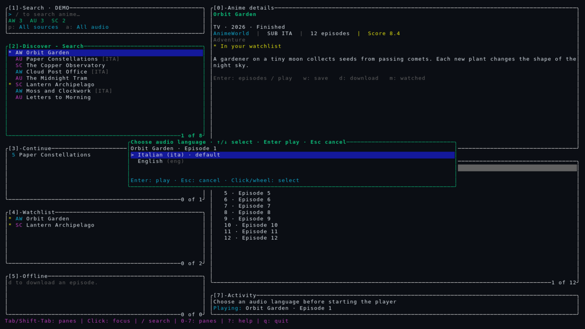

<div align="center">

# anime-levisione

**Your next episode. One terminal.**<br>
Il tuo prossimo episodio. Un solo terminale.

[English](#english) · [Italiano](#italiano)

[](https://github.com/k33wee/anime-levisione/actions/workflows/ci.yml)

[](https://www.gnu.org/licenses/gpl-3.0.html)

A keyboard-first anime browser inspired by lazygit. Built in Rust, with room for your mouse.

</div>


<details>
<summary><strong>Choose your audio before pressing play / Scegli la lingua prima di partire</strong></summary>



*Captured from the running TUI: offline demo above, local bilingual sample here.*<br>
*Catture della TUI in esecuzione: demo offline sopra, file di esempio bilingue qui.*

</details>

## English

### Less browsing. More watching.

- **Three sources, one search:** AnimeWorld, AnimeUnity and StreamingCommunity, with automatic domain discovery.
- **Your library:** watchlist, resume, offline downloads and optional AniList sync.
- **Your controls:** keyboard + mouse, adaptive panes, VLC/mpv and a pre-play audio-language picker.

### Install

Needs **Rust 1.88+** and **VLC or mpv**. Add `ffmpeg` for downloads; `ffprobe` is optional for file audio metadata. Linux, macOS and Windows/WSL.

```sh
git clone https://github.com/k33wee/anime-levisione
cd anime-levisione
cargo install --path .
```

### Go

```sh
anime-levisione "frieren"                    # search and browse
anime-levisione --demo                       # preview: no network or saved data
anime-levisione --player mpv                 # override the player
anime-levisione --private                    # no AniList or automatic history
anime-levisione search "naruto" --json       # script-friendly search
anime-levisione doctor                       # check your setup
```

### Keep your hands on the keyboard

| Key | Action |
| --- | --- |
| `/` | Search |
| `Tab` / `Shift+Tab` · `0`–`7` | Switch / jump to a pane |
| `j/k` · `↑/↓` · `PgUp/PgDn` | Navigate |
| `Enter` · `s` · `n` | Open episodes / play · restart · next episode |
| `w` · `m` · `d` | Watchlist · mark watched · download |
| `Ctrl+x` · `Ctrl+d` | Stop playback · cancel download |
| `?` · `:` · `q` | All shortcuts · commands · quit |

Click to focus a pane or select a row; use the wheel to navigate. All panes fit at **60×18+**; smaller windows zoom the focused pane.

<details>
<summary><strong>Audio, players & settings</strong></summary>

- **Audio:** multiple languages trigger a picker. Select with arrows or a click, then `Enter`; `Esc` cancels. HLS metadata needs no extra tool; other files use optional `ffprobe`. Unavailable metadata falls back to the player default. `a` filters the catalogue, not playback audio.
- **Players:** VLC is the default when installed; its language is chosen at startup. mpv also saves playback progress automatically. With VLC, use `m` to mark episodes watched.
- **Settings:** `,` shows paths. Edit `config.toml` for `player`, `player_args`, download directory or provider mirrors. `--data-dir <path>` keeps a separate library.
- **AniList:** [create an OAuth client](https://anilist.co/settings/developer), then run `anime-levisione login --client-id YOUR_ID` — or log in from the TUI (command palette → *AniList login & sync status*). Sync is opt-in; `logout` disconnects it. Private mode disables AniList entirely.

### Development

```sh
make help        # all targets
make ci          # fmt + clippy + tests + commitlint (run before pushing)
make act         # replay the GitHub workflow locally with act (needs Docker)
make hooks       # install the .githooks commit-msg / pre-push hooks
```

Commits follow [Conventional Commits](https://www.conventionalcommits.org), checked by commitlint in CI (`make commitlint`, or `FROM=main make commitlint` for a whole branch).

</details>

## Italiano

<details>
<summary><strong>Apri la guida in italiano</strong></summary>

### Meno ricerche. Più episodi.

- **Tre fonti, una ricerca:** AnimeWorld, AnimeUnity e StreamingCommunity, con rilevamento automatico dei nuovi domini.
- **La tua libreria:** watchlist, ripresa della visione, download offline e sincronizzazione AniList facoltativa.
- **I tuoi comandi:** tastiera e mouse, pannelli adattivi, VLC/mpv e scelta della lingua prima della riproduzione.

### Installa

Servono **Rust 1.88+** e **VLC o mpv**. Aggiungi `ffmpeg` per scaricare; `ffprobe` è facoltativo per rilevare le lingue nei file. Linux, macOS e Windows/WSL.

```sh
git clone https://github.com/k33wee/anime-levisione
cd anime-levisione
cargo install --path .
```

### Parti

```sh
anime-levisione "frieren"                    # cerca e sfoglia
anime-levisione --demo                       # anteprima: niente rete o salvataggi
anime-levisione --player mpv                 # scegli un altro player
anime-levisione --private                    # niente AniList o cronologia automatica
anime-levisione search "naruto" --json       # ricerca per script
anime-levisione doctor                       # controlla la configurazione
```

### Tutto da tastiera

| Tasto | Azione |
| --- | --- |
| `/` | Cerca |
| `Tab` / `Shift+Tab` · `0`–`7` | Cambia pannello / vai direttamente a un pannello |
| `j/k` · `↑/↓` · `PgUp/PgDn` | Naviga |
| `Enter` · `s` · `n` | Apri gli episodi / riproduci · ricomincia · episodio successivo |
| `w` · `m` · `d` | Watchlist · segna come visto · scarica |
| `Ctrl+x` · `Ctrl+d` | Ferma la riproduzione · annulla il download |
| `?` · `:` · `q` | Tutti i comandi · palette comandi · esci |

Clicca per attivare un pannello o selezionare una riga; usa la rotella per navigare. Tutti i pannelli sono visibili da **60×18**; nelle finestre più piccole viene ingrandito quello attivo.

### Audio, player e impostazioni

- **Audio:** se ci sono più lingue, scegli con le frecce o un clic e conferma con `Enter`; `Esc` annulla. HLS non richiede strumenti extra; per gli altri file si usa `ffprobe`, se disponibile. Senza metadati si avvia l'audio predefinito. `a` filtra il catalogo, non cambia la traccia audio.
- **Player:** VLC è il predefinito, se installato; la lingua viene impostata all'avvio. mpv salva anche il progresso automaticamente. Con VLC, usa `m` per segnare gli episodi come visti.
- **Impostazioni:** `,` mostra i percorsi. In `config.toml` puoi cambiare `player`, `player_args`, cartella dei download e domini alternativi. `--data-dir <percorso>` usa una libreria separata.
- **AniList:** [crea un client OAuth](https://anilist.co/settings/developer), poi esegui `anime-levisione login --client-id IL_TUO_ID` — oppure accedi direttamente dalla TUI (palette comandi → *AniList login & sync status*). La sincronizzazione è facoltativa; `logout` la scollega. La modalità privata disattiva completamente AniList.

### Sviluppo

```sh
make help        # tutti i target
make ci          # fmt + clippy + test + commitlint (da lanciare prima del push)
make act         # ripete la workflow GitHub in locale con act (serve Docker)
make hooks       # installa gli hook .githooks (commit-msg / pre-push)
```

I commit seguono i [Conventional Commits](https://www.conventionalcommits.org), verificati da commitlint in CI (`make commitlint`, oppure `FROM=main make commitlint` per un intero branch).

</details>

---

**GPL-3.0-only** · No warranty / Nessuna garanzia.
